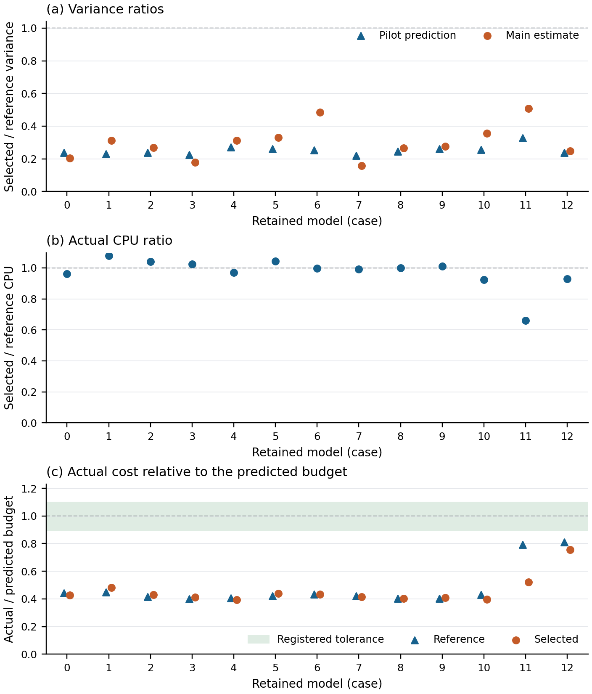

# Exercise-policy loss under computational and financial constraints: numerical findings

Amanjeet Singh  
30 September 2026

Keywords: optimal stopping; American options; martingale duality; Monte Carlo; training uncertainty; computational allocation.

## 1. Question and scope

I investigate how approximate exercise decisions lose value, how tightly that loss can be assessed, and how computational effort should be divided between fitting policies and evaluating them. This supplement reports selected numerical findings in Markdown alongside the [complete conditional research paper](https://github.com/Amanjeet-S/Option-Exercise-Policy-Evaluation/blob/v1.0.0/paper/Exercise_Policy_Loss_under_Computational_and_Financial_Constraints.pdf). The distinction between a better decision and a better assessment is central. A narrower upper bound can result from reducing dual slack while leaving the exercise policy unchanged. Increasing the number of independently fitted policies instead improves information about a training procedure's average performance.

The calculations condition on thirteen related development specifications for one expiry, using observations from a short intraday window on 10 September 2026. These cases are neither independent trading days nor a representative market sample. Each specification uses a one-state diffusion, deterministic funding and a capped discrete cash event. The original calendar contains 27 daily exercise rights. Calibration and historical information restrictions remain relevant even when simulation uncertainty is small. The findings concern the maintained models and their fitted rules; they do not measure losses realised by option holders.

Source: LSEG Workspace, accessed through the University of St Andrews subscription; my calculations. The observation window is 10 September 2026. Retrieval dates are established by the acquisition records and are not inferred from that window. The displayed quantities are selected conditional research findings rather than a redistributed observation dataset. Their release and reuse remain subject to the source assessment in the [publication policy](../docs/publication_policy.md) and [licensing scope](../LICENSING.md).

The original design crosses 5,000 and 20,000 training paths with polynomial degrees two and four. Four repetitions per case give 52 policies per configuration and 208 policies in total. The smaller training sample is a prefix of the larger sample in this original design. Fresh outer simulations assess the frozen policies. A later training-procedure experiment and its allocation follow-up use new, independently generated training pairs. I retain these distinctions when interpreting the tables.

## 2. Tightening a bound without changing the policy

The policy fitting follows the continuation-regression approach of [Longstaff and Schwartz (2001)](#11-references). The martingale comparison applies the dual construction of [Haugh and Kogan (2004)](#11-references), within the established primal-dual framework of [Andersen and Broadie (2004)](#11-references). If $V$ is the optimal value, $V_\pi$ the policy value and $U(M)$ a valid dual upper payoff, the expected gap satisfies

$$
\mathbb E[G_\pi(M)]=(V-V_\pi)+\{\mathbb E[U(M)]-V\}.
$$

The identity uses discounted currency amounts. I divide by the premium-payment discount factor to obtain the premium-quote units reported below. I use the decomposition to attribute changes correctly. Holding the policy fixed, changing the martingale changes the second term. Approximate value functions yield martingale increments by subtracting their conditional expectations. Piecewise-linear representation permits analytical integration under the stipulated transitions. The functions can approximate the value poorly while their increments remain centred in exact arithmetic. Approximation quality governs tightness; conditional centring governs validity.

Table 1 reports mean estimated gaps across the 52 frozen policies in each configuration. All monetary quantities in this supplement are USD per share in premium-quote units. A gap includes both policy loss and dual slack. These equal-weight averages describe retained calculations and do not have a market-population interpretation.

<!-- table:measurement -->

| Training paths | Degree | Slope gap | Coarse value gap | Fine value gap | Reduction (per cent) |
| --- | --- | --- | --- | --- | --- |
| 5,000 | 2 | 0.652833 | 0.051285 | 0.051125 | 92.17 |
| 5,000 | 4 | 0.703839 | 0.060522 | 0.060364 | 91.42 |
| 20,000 | 2 | 0.624587 | 0.037099 | 0.036941 | 94.09 |
| 20,000 | 4 | 0.506690 | 0.024304 | 0.024150 | 95.23 |

<!-- endtable:measurement -->

The fine value construction reduces the mean gap by 91.42 to 95.23 per cent relative to the slope construction. Its improvement over the coarse value construction is much smaller. The exercise instructions are identical throughout this comparison, so the reduction provides more informative evidence about their loss rather than recovering additional policy value. I do not replace the unknown optimum with a deterministic grid price. Non-nested upper evaluation is also established in [Belomestny, Bender and Schoenmakers (2009)](#11-references); analytical centring alone is not a claim of theoretical novelty.

## 3. Changing the terminal instruction

The terminal experiment adds ninety minutes to the original endpoint, assumes no intervening cash event and preserves the settlement threshold and volatility dynamics. A surviving policy waits until the later endpoint; all earlier instructions remain fixed. Under these assumptions, conditional convexity gives a non-negative expected gain from this adjustment. Individual realised payoffs can nevertheless decrease. The paper derives the conditional payoff and states why the no-cash and constant-threshold assumptions are needed.

Table 2 integrates the extra diffusion and replaces the original terminal reward by its conditional later value. Endpoint dominance makes this original-clock stopping problem equivalent in optimal value to the expanded calendar. Both instructions use its common upper payoff, which cancels pathwise, so the expected-gap reduction identifies the policy-value gain under the model. The separate direct calculation uses simulated later payoffs and can have different pathwise gaps and sampling variance. Each entry again averages 52 original policies. These integrated gaps must not be confused with the original-calendar gaps in Table 1.

<!-- table:terminal_adjustment -->

| Training paths | Degree | Unadjusted gap | Adjusted gap | Paired policy gain |
| --- | --- | --- | --- | --- |
| 5,000 | 2 | 0.06111782 | 0.05009106 | 0.01102676 |
| 5,000 | 4 | 0.07063052 | 0.06023823 | 0.01039229 |
| 20,000 | 2 | 0.04703011 | 0.03593234 | 0.01109777 |
| 20,000 | 4 | 0.03441110 | 0.02377610 | 0.01063500 |

<!-- endtable:terminal_adjustment -->

For the 20,000-path degree-four configuration, the estimated gap falls from 0.03441110 to 0.02377610, a gain of 0.01063500. This conclusion concerns an admissible terminal adjustment under explicit financial assumptions. It does not establish that retraining the earlier regressions improves every policy. In the separate matched terminal-target retraining experiment at the ninety-minute extension, the 208 pointwise comparisons comprise 81 positive intervals, 108 negative intervals and 19 intervals containing zero. These dependent, conditional comparisons illustrate the difference between an analytical improvement of an instruction and refitting a finite-sample decision rule.

## 4. Training variation and evaluation noise

I next compare degree-four policies fitted with 5,000 and 20,000 paths using eight independent training pairs per case. The samples at the two training sizes are independent, rather than nested. The primary comparison uses the finer value approximation and 80,000 evaluation paths. Common evaluation paths and a common martingale within each pair allow the policy-value difference to be estimated without including a difference in upper payoffs.

Table 3 reports mean gains, approximate pointwise 95 per cent Student intervals across the eight pair means, and the estimated share of mean-estimator variance attributable to evaluation noise. The intervals concern the procedures' average gain within a fixed specification. Their nominal coverage with eight repetitions has not been validated, and the thirteen intervals do not provide simultaneous inference.

<!-- table:training_evaluation -->

| Case | Mean gain | Pointwise 95 per cent interval | Evaluation share (per cent) |
| --- | --- | --- | --- |
| 0 | 0.03203 | [0.00922, 0.05484] | 0.071 |
| 1 | 0.02721 | [0.00193, 0.05249] | 0.046 |
| 2 | 0.02941 | [-0.00635, 0.06517] | 0.029 |
| 3 | 0.04352 | [0.01747, 0.06958] | 0.077 |
| 4 | 0.03362 | [0.01262, 0.05462] | 0.123 |
| 5 | 0.03872 | [0.02509, 0.05236] | 0.284 |
| 6 | 0.03173 | [0.01776, 0.04570] | 0.152 |
| 7 | 0.03283 | [0.01873, 0.04694] | 0.179 |
| 8 | 0.02892 | [0.01123, 0.04661] | 0.144 |
| 9 | 0.01419 | [-0.00237, 0.03076] | 0.107 |
| 10 | 0.05397 | [-0.00186, 0.10980] | 0.014 |
| 11 | 0.03105 | [0.02017, 0.04194] | 0.267 |
| 12 | 0.03255 | [0.00226, 0.06285] | 0.056 |

<!-- endtable:training_evaluation -->

Every estimated mean is positive, but the intervals for cases 2, 9 and 10 contain zero. Eight of the 104 individual pair gains are negative. Omitting repetitions one at a time leaves every reduced-sample mean positive, while the positive-interval conclusions for cases 1 and 12 depend on the omission. I retain the primary estimates and use this diagnostic to qualify the small-sample interpretation.

Let $D$ denote a newly generated training pair, $\Delta(D)$ its conditional mean gain and $\sigma_D^2$ the conditional variance of a martingale-adjusted pathwise gain. Define $A=\mathrm{Var}\{\Delta(D)\}$ and $B=\mathbb E[\sigma_D^2]$. For $R$ independent pairs, each evaluated on $N$ conditionally independent paths,

$$
\mathrm{Var}(\widehat\mu)=\frac{A}{R}+\frac{B}{RN}.
$$

Conditional averaging and the law of total variance give this identity. I use it because additional evaluation paths reduce only the second component, whereas additional independent pairs reduce both. The estimated evaluation shares of 0.014 to 0.284 per cent motivate a different allocation of computation. They are estimates from eight repetitions, not known population variance components.

## 5. Independent allocation comparison

A fresh pilot fits 32 independent pairs per case and evaluates each on 4,096 paths. Separate timing measurements cover 128, 256, 512, 1,024, 2,048 and 4,096 evaluation paths. The reference uses 64 pairs with 4,096 paths each. The selector minimises the estimated variance over affordable integer pair counts from 64 to 1,024 and the measured path grid, using the pilot's predicted reference CPU budget. A non-positive estimated variance component would invoke the reference allocation. No extrapolated path count is used.

The pilot determines each allocation before independent main draws. The reference and selected arms have independent training and evaluation streams; both policies within a pair share evaluation paths. These choices preserve a common procedure-level target. Increasing the number of fitted pairs changes precision about the average gain, rather than the expected performance of either training procedure.

The main comparison completes 832 reference pairs and 4,198 selected pairs, giving 5,030 pairs overall. Table 4 reports the allocations and descriptive selected-to-reference ratios. Variance means the estimated variance of the mean gain, not a pathwise variance or mean squared error. CPU means the standalone process CPU charge, including each arm's setup.

<!-- table:allocation_comparison -->

| Case | Selected pairs | Paths per pair | Pilot variance ratio | Main variance ratio | CPU ratio | Variance × CPU ratio |
| --- | --- | --- | --- | --- | --- | --- |
| 0 | 306 | 256 | 0.237 | 0.204 | 0.962 | 0.197 |
| 1 | 352 | 256 | 0.230 | 0.311 | 1.078 | 0.336 |
| 2 | 327 | 256 | 0.238 | 0.268 | 1.041 | 0.279 |
| 3 | 332 | 256 | 0.224 | 0.179 | 1.026 | 0.184 |
| 4 | 318 | 256 | 0.272 | 0.311 | 0.970 | 0.302 |
| 5 | 318 | 256 | 0.262 | 0.331 | 1.042 | 0.345 |
| 6 | 338 | 256 | 0.253 | 0.486 | 0.998 | 0.485 |
| 7 | 335 | 256 | 0.220 | 0.157 | 0.991 | 0.155 |
| 8 | 333 | 256 | 0.246 | 0.266 | 1.001 | 0.266 |
| 9 | 320 | 256 | 0.261 | 0.277 | 1.011 | 0.280 |
| 10 | 279 | 256 | 0.255 | 0.356 | 0.924 | 0.329 |
| 11 | 253 | 256 | 0.327 | 0.507 | 0.659 | 0.334 |
| 12 | 387 | 128 | 0.238 | 0.247 | 0.930 | 0.230 |

<!-- endtable:allocation_comparison -->

The selected allocations use 256 evaluation paths in twelve cases and 128 in case 12. The latter lies at the measured grid boundary and provides no evidence about smaller path counts. Main variance ratios range from 0.157 to 0.507, and variance-times-CPU ratios from 0.155 to 0.485. All are below one. These are descriptive estimates without ratio confidence intervals. Several main ratios are less favourable than the pilot predicted, especially for cases 6 and 11.

Table 5 reports the corresponding procedure-level gains and approximate pointwise 95 per cent Student intervals across independent training-pair means. Both arms have positive intervals in every case. Their additional independent training repetitions give more information than the earlier eight-pair study, but they do not validate interval coverage or convert related development cases into independent market confirmations.

<!-- table:allocation_gains -->

| Case | Reference mean | Reference interval | Selected mean | Selected interval |
| --- | --- | --- | --- | --- |
| 0 | 0.03407 | [0.02661, 0.04153] | 0.02988 | [0.02656, 0.03319] |
| 1 | 0.02515 | [0.01936, 0.03094] | 0.03296 | [0.02978, 0.03614] |
| 2 | 0.03214 | [0.02590, 0.03838] | 0.03354 | [0.03035, 0.03672] |
| 3 | 0.03219 | [0.02472, 0.03966] | 0.02970 | [0.02658, 0.03281] |
| 4 | 0.03112 | [0.02517, 0.03707] | 0.03028 | [0.02701, 0.03355] |
| 5 | 0.02989 | [0.02381, 0.03598] | 0.03136 | [0.02791, 0.03481] |
| 6 | 0.02916 | [0.02361, 0.03472] | 0.03502 | [0.03121, 0.03883] |
| 7 | 0.03858 | [0.02998, 0.04718] | 0.03161 | [0.02826, 0.03497] |
| 8 | 0.02732 | [0.02058, 0.03406] | 0.03141 | [0.02799, 0.03483] |
| 9 | 0.03380 | [0.02761, 0.04000] | 0.03278 | [0.02957, 0.03600] |
| 10 | 0.03578 | [0.02878, 0.04279] | 0.04138 | [0.03726, 0.04549] |
| 11 | 0.03114 | [0.02531, 0.03698] | 0.03381 | [0.02972, 0.03791] |
| 12 | 0.03329 | [0.02667, 0.03991] | 0.03304 | [0.02980, 0.03628] |

<!-- endtable:allocation_gains -->

## 6. CPU prediction failed to transfer

Every one of the 26 main arms falls below the registered budget tolerance. Actual CPU divided by the pilot's reference budget ranges from 0.392 to 0.811, against the accepted interval of 0.9 to 1.1. The selected-to-reference actual CPU ratios are closer to one, ranging from 0.659 to 1.078, but this does not establish a comparison at exactly equal realised cost. I retain the prescribed allocations instead of adding repetitions after observing the unused predicted budget.



Figure 1. The top panel compares predicted and estimated variance ratios; the middle panel compares actual CPU charges; the bottom panel retains each arm's expenditure relative to its pilot reference budget and the tolerance band. Points are descriptive and have no ratio confidence intervals. The failed budget predictions remain visible where the two arms happen to have similar realised costs. Source for the financial specifications: LSEG Workspace through the University of St Andrews subscription, using the 10 September 2026 observation window; ratios and CPU measurements are my calculations. The caption must accompany the image when it is distributed separately.

Table 6 decomposes aggregate CPU charges in seconds. Predictions retain the training and evaluation components of the pilot observation supplying the median total pair cost. Summing separate component medians would generally change the prediction. Small discrepancies in totals reflect displayed rounding.

<!-- table:allocation_costs -->

| Component | Reference predicted | Reference actual | Selected predicted | Selected actual |
| --- | --- | --- | --- | --- |
| Setup | 2.333 | 1.104 | 2.333 | 1.060 |
| Training | 75.569 | 34.814 | 366.801 | 166.359 |
| Evaluation | 595.503 | 270.059 | 303.460 | 129.534 |

<!-- endtable:allocation_costs -->

Predicted totals of 673.405 and 672.594 CPU seconds become 305.977 and 296.953 seconds for the reference and selected arms. Both training and evaluation become cheaper; setup explains less than one per cent of either shortfall. Recorded software and requested thread settings agree across stages, but effective native thread counts and processor conditions were not measured. The evidence does not identify the cause of the cost change.

The pilot additionally consumes 457.980 process CPU seconds and 639.279 elapsed seconds. Its expense must be included when assessing a one-off application. Process CPU and elapsed time measure different aspects of expenditure and are not interchangeable. These frozen results support improved estimated precision about the training gain under the retained specifications. They do not establish a transferable CPU budget, an equal-cost optimum or the best allocation for assessing one frozen policy. The separately specified timing experiment in Section 8 assesses new forecasts. It does not retrospectively repair these original predictions.

## 7. Prospective allocation under a fixed design

I next selected cases 5, 6 and 10 because the preceding analysis exposed ambiguity in the variance components or sensitivity to the cost scenario. I fixed three candidate allocations in each case, using 128, 256 and 4,096 evaluation paths, before drawing new samples. Each independent pair again trains degree-four policies on 5,000 and 20,000 paths and estimates their gain with shared evaluation paths. The nine arms complete 3,978 pairs; four warm-up pairs are separate. The financial specifications are unchanged. This experiment is prospective conditional on the selected design and earlier information, and introduces no new market observations.

For $R$ independent pair means, the sample variance divided by $R$ estimates the variance of their mean. Conditional on the fixed design and the independent sampling model, that estimator is unbiased. It does not estimate mean squared error against an observed population truth. The counts in Table 7 satisfy both retained planning-cost scenarios. A prespecified rule minimising the worst relative variance over a declared enclosure of the asymptotic Fieller component-ratio set selects 256 paths in all three cases. The ratio construction follows [Fieller (1954)](#11-references) and the inversion account in [von Luxburg and Franz (2009)](#11-references); its application here uses asymptotically normal component contrasts rather than an exact normal-sample result. That decision is conditional on the set and cost assumptions; it does not certify that they contain the unknown population ratio or future expenditure.

<!-- table:prospective_allocation -->

| Case | Pairs, 128 paths | Pairs, 256 paths | Pairs, 4,096 paths | Variance ratio, 128 | Variance ratio, 256 | CPU ratio, 256 | Variance × CPU ratio, 256 |
| --- | --- | --- | --- | --- | --- | --- | --- |
| 5 | 776 | 687 | 91 | 0.169888 | 0.167421 | 1.510736 | 0.252928 |
| 6 | 674 | 632 | 141 | 0.396693 | 0.340606 | 0.901768 | 0.307147 |
| 10 | 438 | 399 | 140 | 0.364378 | 0.330904 | 0.655844 | 0.217021 |

<!-- endtable:prospective_allocation -->

Table 7. Independent pair counts and descriptive efficiency ratios for the prospective experiment. Each ratio uses the freshly simulated 4,096-path reference within the same case. CPU includes the arm's approximation construction, training and evaluation. The selected 256-path variance estimates are 16.7, 34.1 and 33.1 per cent of the reference estimates. Their variance-times-CPU ratios remain below one, but actual expenditures differ. These figures do not establish an improvement at exactly equal realised cost.

I registered twelve contrasts: six differences in mean gain and six differences in the variance of the complete-sample mean. Each subtracts the 4,096-path reference from a smaller-path alternative. The intervals in Table 8 use the common cutoff $13/4$ and plug-in sampling variances, with asymptotic calibration for the twelve-contrast family. Their finite-sample coverage has not been validated. Mean differences are in USD per share in premium-quote units; variance differences are in squared premium-quote units. These are difference intervals, not confidence limits for the ratios in Table 7.

<!-- table:prospective_contrasts -->

| Case | Evaluation paths | Mean-difference interval | Variance-difference interval |
| --- | --- | --- | --- |
| 5 | 128 | [-0.009932236, 0.01029046] | [-1.091314e-05, -2.823286e-06] |
| 5 | 256 | [-0.009629916, 0.01057145] | [-1.093775e-05, -2.839513e-06] |
| 6 | 128 | [-0.005816441, 0.009489616] | [-3.959426e-06, -8.309205e-07] |
| 6 | 256 | [-0.005216458, 0.009779123] | [-4.164466e-06, -1.071226e-06] |
| 10 | 128 | [-0.01285611, 0.009544336] | [-1.018491e-05, -8.808303e-07] |
| 10 | 256 | [-0.01311862, 0.009005322] | [-1.041016e-05, -1.23835e-06] |

<!-- endtable:prospective_contrasts -->

All six mean intervals include zero and all six variance-difference intervals have negative upper endpoints. The first finding is compatible with the common target, but does not establish equivalence. The second supports the precision comparison under the stated asymptotic procedure. The 256-path arm has lower point-estimated variance than the 128-path arm in each case, but that comparison lies outside the registered inferential family. I do not claim statistically established superiority between those two candidates.

Fourth-moment concentration qualifies the variance inference. In case 5's 256-path arm, one pair contributes 63.98 per cent of the squared variance-influence sum. The corresponding largest contribution is 49.84 per cent in case 10's reference. These percentages concern estimated uncertainty about variance, not the share of the variance itself. No pair is removed. Large replication counts and a conservative cutoff do not by themselves validate the normal approximation under this observed concentration.

All nine arms remain within their original numerical budgets, but none meets the ten per cent forecast tolerance. Actual-to-forecast ratios range from 0.514162 to 0.873429. The primary numerical charge is 349.644 CPU seconds against a combined forecast of 487.779 seconds. Fixed counts are retained despite unused predicted budgets. The result strengthens the observed precision comparison while leaving expenditure prediction unresolved at this stage.

## 8. Local calibration of CPU forecasts

I separately tested whether new local timing measurements improve predictions for those same nine complete allocations. Two passes execute fixed counts in opposite orders, giving 7,956 validation pairs, 576 calibration pairs and four warm-up pairs. At each pass's start, sixteen calibration pairs per arm determine a forecast of the complete arm. A second set of sixteen pairs immediately before each arm determines an immediate forecast. Both extrapolate the measured mean pair cost and include a fresh approximation construction. The unchanged historical forecast supplies the third comparison. The middle arm necessarily retains its middle position under reversal.

For each complete arm, I define absolute relative error as $|C-\widehat C|/\widehat C$, with actual numerical CPU $C$ and forecast $\widehat C$. Table 9 averages this error equally across eighteen arms. The tolerance requires $C/\widehat C$ to lie between 0.9 and 1.1. The separate upper allowance is $1.1\widehat C$ and has no probabilistic coverage interpretation.

<!-- table:cpu_prediction -->

| Forecast | Within ten per cent | Within upper allowance | Mean absolute relative error (per cent) | Actual/forecast range |
| --- | --- | --- | --- | --- |
| Historical | 1/18 | 18/18 | 29.065 | [0.5154, 1.0782] |
| Pass-start calibration | 16/18 | 16/18 | 3.669 | [0.9237, 1.2081] |
| Immediate calibration | 17/18 | 17/18 | 2.841 | [0.9576, 1.2261] |

<!-- endtable:cpu_prediction -->

Local calibration reduces mean absolute relative error from 29.065 per cent to 3.669 per cent at pass start and 2.841 per cent immediately before execution. The immediate forecast meets the tolerance in seventeen of eighteen arms. Its remaining failure reaches an actual-to-forecast ratio of 1.2261 and exceeds the original numerical budget. Every point predictor classifies all eighteen arms as affordable, although only seventeen are. Thus improved average prediction does not guarantee budget protection.

The historical upper allowance contains all eighteen observed costs, but classifies none of the arms as affordable at the unchanged budgets. The pass-start and immediate allowances classify eighteen and seventeen arms as affordable, respectively; each still makes one false affordability declaration. The comparison therefore separates tolerance, upper-allowance exceedance and affordability. A conservative forecast can cover every retained cost while being unusable for the planned allocations.

Validation consumes 700.274 numerical CPU seconds. Pass-start and immediate calibration add 44.623 and 44.323 seconds; warm-up adds 0.332 seconds. Total numerical expenditure is 789.552 CPU seconds, while the measured process consumes 811.658 CPU seconds and 842.795 elapsed seconds. Process timing includes in-run recording and control operations, but excludes interpreter startup, pre-launch verification and post-run manifest hashing. Charging either calibration scheme alone to its associated validation arm retains seventeen affordable arms. Charging both schemes, as actually performed in this comparison, leaves fourteen. The latter count describes the two-scheme experiment, not deployment of immediate calibration alone.

These two passes share one operating session. Fresh simulation streams do not make processor conditions independent and identically distributed, and reversed order does not identify a causal order effect. I make no statistical prediction-coverage claim or cross-device guarantee. Numerical kernels are unchanged, but the timing extension retains compact verification records instead of serialising every fitted coefficient; whole-process expenditure consequently belongs to this recording workflow. I use these runs only to assess cost prediction, not as additional inference about financial policy gains.

## 9. Empirical limits

A prospective protocol specified fifteen intended matched observations over five sessions, 21 to 25 September 2026. None passed the primary quote-measurement rule. There is therefore no prospective volatility fit, held-out put prediction or exercise-policy performance estimate. An empty eligible sample is neither a zero loss nor a rejection of the pricing model. More permissive exploratory screens cannot replace the primary rule after inspection.

The computational findings consequently remain conditional. Funding, distribution entitlements, quote alignment and historical contract terms require independent validation before the results can support claims about actual exercise performance. Additional state variables would also change the numerical problem: a deterministic value approximation is particularly effective in this one-state setting. Neither greater simulation precision nor more complex probability theory removes these financial and empirical restrictions.

## 10. Public evidence and reproducibility

The [released summaries](numerical_results.json) contain derived research outputs, including the displayed gains, intervals and CPU comparisons. Raw subscription observations, quote midpoints and spreads, exact financial inputs and reconstructable input supplements remain private under the [publication policy](../docs/publication_policy.md). Rounding controls presentation; it is not used to disguise restricted observations. Publication permission for derived findings does not make the underlying subscription data redistributable.

From the repository root, the following standard-library command verifies the nine table renderings, case coverage, declared summary fields and selected arithmetic identities:

```bash
python3 paper/verification/numerical_results.py
```

This check does not rerun simulations or independently verify the summaries against restricted observations. The [replication package](../replication/README.md) supplies the relevant implementation, historical entry points and a public mathematical example. Exact replay of the original financial experiments additionally requires their licensed input archive and source versions. The consolidated paper includes these derived findings; observation-level inputs and original evidence records remain private.

## 11. References

Andersen, L. and Broadie, M. (2004). Primal-dual simulation algorithm for pricing multidimensional American options. *Management Science*, 50(9), 1222–1234. [doi:10.1287/mnsc.1040.0258](https://doi.org/10.1287/mnsc.1040.0258).

Belomestny, D., Bender, C. and Schoenmakers, J. (2009). True upper bounds for Bermudan products via non-nested Monte Carlo. *Mathematical Finance*, 19(1), 53–71. [doi:10.1111/j.1467-9965.2008.00357.x](https://doi.org/10.1111/j.1467-9965.2008.00357.x).

Fieller, E. C. (1954). Some problems in interval estimation. *Journal of the Royal Statistical Society, Series B (Methodological)*, 16(2), 175–185. [doi:10.1111/j.2517-6161.1954.tb00159.x](https://doi.org/10.1111/j.2517-6161.1954.tb00159.x).

Haugh, M. B. and Kogan, L. (2004). Pricing American options: A duality approach. *Operations Research*, 52(2), 258–270. [doi:10.1287/opre.1030.0070](https://doi.org/10.1287/opre.1030.0070).

Longstaff, F. A. and Schwartz, E. S. (2001). Valuing American options by simulation: A simple least-squares approach. *The Review of Financial Studies*, 14(1), 113–147. [doi:10.1093/rfs/14.1.113](https://doi.org/10.1093/rfs/14.1.113).

von Luxburg, U. and Franz, V. H. (2009). A geometric approach to confidence sets for ratios: Fieller's theorem, generalizations, and bootstrap. *Statistica Sinica*, 19(3), 1095–1117. [Published article](https://www3.stat.sinica.edu.tw/sstest/j19n3/j19n312/j19n312.html).

These references identify the established methodological foundations. The [literature comparison](contribution_review.md) records the source versions and material consulted for the paper. This supplement consolidates retained experiments and does not claim a new general theorem or a further full-paper literature review.

For ratio inference, I consulted the final journal text of von Luxburg and Franz (2009), including the inversion arguments on pages 1101–1105, and visually checked pages 1102–1103. For Fieller (1954), I read the publisher's extracted text of pages 175–177, including equations (5)–(10). I did not visually inspect those original pages; the accessible text and the checked 2009 presentation support the formula transcription.
